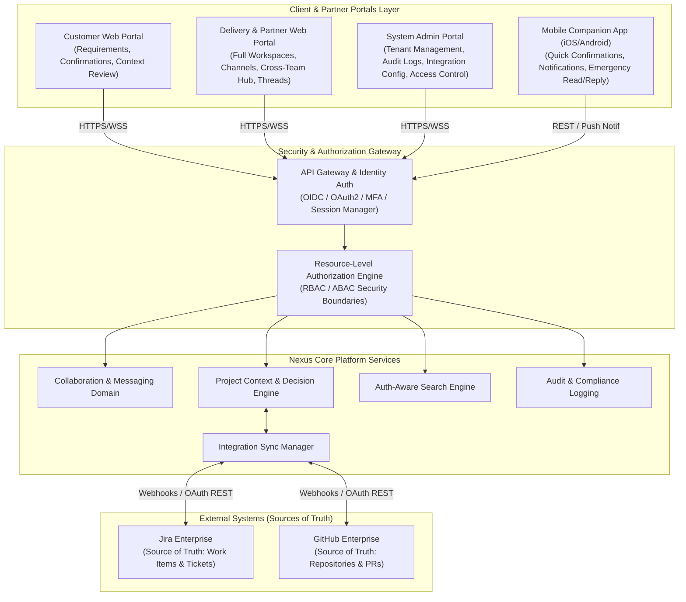

# Phase 01: Business Analysis — System Context & Topology Diagram

## 1. Multi-Portal & Multi-Client Architecture Overview

Nexus provides targeted access points designed specifically for different operational stakeholders:
1. **Customer Web Portal:** Dedicated workspace for Clients & Product Sponsors to review context, approve requirements, and confirm decisions.
2. **Delivery & Partner Web Portal:** Full-featured operational workspace for Business Analysts, Backend/Frontend Developers, QA Engineers, and Partner/ODC Teams.
3. **System Admin Portal:** Administrative suite for platform governance, organization tenant management, security audits, break-glass policy enforcement, and integration management.
4. **Mobile Companion Apps (iOS / Android):** Lightweight mobile client focused on high-priority alerts, message viewing, approval notifications, and quick customer confirmation actions.

---

## 2. Comprehensive System Architecture Diagram

---

## 3. Site & Client Capabilities Breakdown

### 3.1. Customer Web Portal (`customer-portal`)
- **Primary Users:** Clients, Product Owners, External Sponsors.
- **Key Features:**
  - Executive Context Dashboard (Decision timeline, requirement changes).
  - One-click **Customer Confirmation Action** on requirement proposals.
  - Controlled access to `Project Common Hub` channels.
  - Restricted view (cannot see internal delivery team private channels).

### 3.2. Delivery & Partner Web Portal (`delivery-portal`)
- **Primary Users:** BAs, Developers, QA Engineers, DevOps, ODC Partner Teams.
- **Key Features:**
  - Full multi-channel messaging (Project Channels, Private Team Channels, DMs, Threads).
  - Requirement & Decision tagging tools.
  - External Reference integration (linking Jira tickets & GitHub PRs directly to messages).
  - Real-time Cross-Team Hub notifications.

### 3.3. System Administration Portal (`admin-portal`)
- **Primary Users:** System Administrators, Security Officers, Compliance Auditors.
- **Key Features:**
  - Multi-tenant Organization & Project configuration.
  - Break-Glass access request & audit approval workflows.
  - Security logs & Immutable Audit Trail review.
  - Enterprise Integration (Jira/GitHub OAuth & Webhook key rotation).

### 3.4. Mobile Companion Client (`mobile-app`)
- **Target OS:** iOS & Android.
- **Scope & Limitations (Intentionally Restricted):**
  - **Focus:** Quick response & notification center (Push Notifications).
  - **Capabilities:** View priority messages, review decision requests, execute 1-tap customer confirmations, basic DM/channel replies.
  - **Limitations:** No heavy search analytics, no admin configuration, simplified external reference creation to optimize mobile UI/UX.

---

## 4. Multi-Tenant & Portal Access Control Matrix

| Portal / Client | Organization Isolation | Project Isolation | Internal Team Private Channels | Integration Config | Audit Log Access |
| :--- | :---: | :---: | :---: | :---: | :---: |
| **Customer Portal** | ✅ Restricted | ✅ Assigned Only | ❌ No Access | ❌ No | ❌ View Own Scope |
| **Delivery Portal** | ✅ Restricted | ✅ Assigned Only | ✅ Based on Team | ❌ Read-Only Link | ❌ No |
| **Admin Portal** | ✅ Full Tenant | ✅ All Tenant Projs | ❌ Break-Glass Only | ✅ Full Access | ✅ Complete Audit |
| **Mobile App** | ✅ Restricted | ✅ Assigned Only | ✅ Based on Team | ❌ No | ❌ No |
