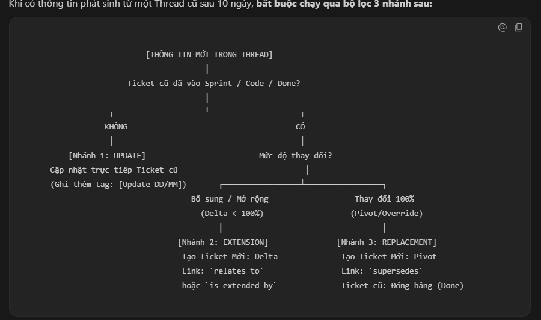

1. Ai được khởi tạo đề xuất chính thức? (BA hay Customer hay PM)
   Dat: PM cấu hình chanel, các thread có thể khởi tạo từ nhiều bên
   Huy: BA vì cần 1 người có thể đứng ra chịu trách nhiệm về tính chính xác và BA sẽ  người chuyển yêu cầu của khách thành requirement có cấu trúc
3. Nếu 1 thread đưa ra một thay đổi ở 1 phần nào đó mà khách không đồng ý thì quy trình đi đâu?(cái ni chắc là đóng thread)
   Dat: Chưa clear câu hỏi lắm?
   Huy : Khách bấm Reject ( thì nên bắt buộc ghi lý do) → thread sang REJECTED, giữ nguyên lịch sử + tạo summary link → read-only rồi tự lock sau 10 ngày. Muốn làm tiếp thì BA mở đề xuất mới link về thread cũ — không được hồi sinh bản đã bị reject.  
5. nếu mà khi giải quyết xong 1 thread thì có đóng thread đó hay không? nếu mà đóng thì nếu mà có thay đổi thì xử lý như răng (có mở thêm 1 thread khác không)
   Dat:
   Problem => chanel => thread nội bộ => trao đổi.
   Approve:
    ==> khởi tạo link sumary
    Khởi tạo ticket jira => gắn ticket như là bản confirm của thread => close thread => thread hoạt động thêm 10 ngày => cấm chat (ĐỌC ĐƯỢC!)
    ---
   ==> bổ sung thông tin (ticket), // link => thread  ==> cắt cái đoạn thảo luận cái này. ? 
    ---------------->  ticket <------------- ticket <
    thiết kế: 
    
    ---
                                [THÔNG TIN MỚI TRONG THREAD]
                                         │
                        Ticket cũ đã vào Sprint / Code / Done?
                                         │
                    ┌────────────────────┴────────────────────┐
                   KHÔNG                                     CÓ
                    │                                         │
           [Nhánh 1: UPDATE]                         Mức độ thay đổi?
       Cập nhật trực tiếp Ticket cũ                            │
       (Ghi thêm tag: [Update DD/MM])       ┌─────────────────┴─────────────────┐
                                      Bổ sung / Mở rộng                   Thay đổi 100%
                                        (Delta < 100%)                   (Pivot/Override)
                                            │                                   │
                                   [Nhánh 2: EXTENSION]               [Nhánh 3: REPLACEMENT]
                                    Tạo Ticket Mới: Delta              Tạo Ticket Mới: Pivot
                                    Link: `relates to`                 Link: `supersedes`
                                    hoặc `is extended by`              Ticket cũ: Đóng băng (Done)

   ==> update ticket 
    ticket tạo ra ==> 
   Rejected:
    ==> khởi tạo link sumary
    ==> đóng sau 10 ngày unactive
PM có khả setting ai là người được mở thread, 2 trường hợp: Huy: BA trung tâm, Đạt: ai cũng nói được
==>
------------------
4.Khách confirm nhầm (ví dụ "15s" thay vì "1.5s") thì xử lý sao, khi BR-01 quy định confirmation là bất biến? Có cơ chế thu hồi hoặc sửa không, ai được kích hoạt?
==> có ticket => cút
tạo ticket mới ==> dùng mối quan hệ trong jira để thay thế
------------------

-----------------
admin : web
khách: web + app
nội bộ: web +app
nền tảng thứ 3: extendsion (optional==> extend teams hoặc discord)
=> thu thập thông  ==> bộ nhớ chung ==> xem không sửa như bảng tin kho lưu trữ. 
==> xây search elas + agent để kqua ==> trả lời => điều hướng tới link tin nhắn, đoạn confirm 
-----------------
chanel: 
agent cá nhân người dùng gán api discord tele
sub chanel cho từng team
==> thread
==> thread 
-------------
api jira
jira --- github 
jira với mình
------------

-aaaa-
tin nhắn ==> hợp đồng khá hợp 
cần người 
7.break-glass access thuộc nhóm rủi ro Elevation of Privilege và cần biện pháp là "mandatory break-glass approval" nôm na là bắt buộc phê duyệt thì vậy ai là người phê duyệt, khi xảy ra sự cố thì việc vận hành rủi ro như thế nào, trong bao lâu, ai là người chịu trách nhiệm ? 
8. khi mà kí confirrm thì nếu ko phải customer chính chủ kí mà là một ai đó khác thì làm sao xác  nhận dc đó là chính chủ và ko phải chịu rủi ro xác thực nào

