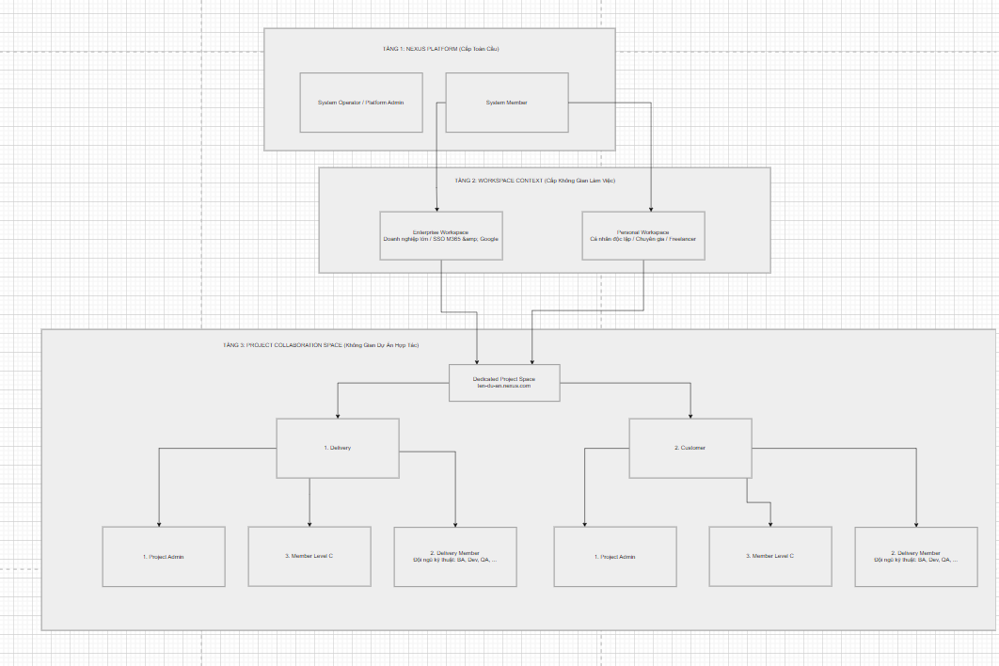

# Phase 02: Requirements Engineering — Nexus Enterprise Roles & Permissions Specification

> **Tài liệu chuẩn hóa:** Hệ thống phân tầng vai trò (Role Hierarchy), ma trận quyền hạn (RBAC/ABAC Matrix) và cơ chế đối xứng đa tổ chức tích hợp C-Level (Symmetric Bilateral Model with Executive C-Level) của nền tảng **Nexus Enterprise**.

---

## 🏛️ SƠ ĐỒ KIẾN TRÚC ROLE 3 TẦNG ĐỐI XỨNG CẬP NHẬT (SYMMETRIC BILATERAL WITH C-LEVEL)


## I. ĐẶC TẢ CHI TIẾT 3 TẦNG QUẢN TRỊ

### 1. TẦNG 1: NEXUS PLATFORM (Cấp Toàn Cầu)
* **`System Operator / Platform Admin`:**
  * Vận hành hạ tầng đám mây, cụm cơ sở dữ liệu, quản lý hạn ngạch (Storage Quota), thanh toán thuê bao (Billing) và bảo mật mức hạ tầng.
  * **Nguyên tắc bảo mật Zero-Knowledge (NFR-SEC-01):** Tuyệt đối **KHÔNG** có quyền truy cập, đọc hay can thiệp vào dữ liệu nội dung, tin nhắn, ticket của các dự án.
* **`System Member`:**
  * Định danh tài khoản cá nhân đã xác thực (Email + Master Key / Passkey PIN).
  * Sở hữu Company Dashboard riêng, có quyền khởi tạo không gian làm việc hoặc dự án mới.

---

### 2. TẦNG 2: WORKSPACE CONTEXT (Cấp Không Gian Làm Việc & Quản Trị Pháp Nhân)
* **`Enterprise Workspace` (Tập đoàn / Doanh nghiệp lớn / ODC):**
  * Tích hợp **SSO tập trung (Microsoft 365, Google Workspace, Azure AD)**: Đồng bộ chức danh (Job Title), phòng ban (Department) và sơ đồ tổ chức (Org Chart).
  * **Cơ chế Phế truất & Kế thừa (Succession Policy):** `Org Admin` tại Tầng 2 giữ quyền lực tối cao để bổ nhiệm, bãi nhiệm hoặc chuyển giao quyền `Project Admin` của bất kỳ nhân sự nào thuộc công ty mình đang tham gia ở Tầng 3 khi có biến động nhân sự.
* **`Personal Workspace` (Cá nhân Độc lập / Chuyên gia / Freelancer):**
  * Dành cho cá nhân dùng email phổ thông (`@gmail.com`).
  * Tự động sở hữu kho lưu trữ an toàn riêng biệt (**`#personal-vault`**).

---

### 3. TẦNG 3: PROJECT COLLABORATION SPACE (Mô Hình Đối Xứng Hai Bên Tích Hợp C-Level)
Mỗi bên (Delivery và Customer) đều sở hữu bộ 3 vị trí quyền lực đối xứng hoàn hảo:

#### A. PHÍA THỰC THI (1. DELIVERY SIDE - Nhà Thầu / ODC):
1. **`1. Project Admin (Delivery Lead / PM)`:**
   * Quản trị kỹ thuật tác chiến: Cấu hình phân luồng kênh (`#general`, `#project-memory`).
   * Quản lý quân số kỹ thuật: Mời và phân công kỹ sư.
   * Cấp phát mã an ninh kỹ thuật: Sinh Token dòng lệnh **`$ nexus sync`**, cấu hình Webhook Jira/GitHub.
   * Mở Cổng An ninh (PIN Gate `1234`) để kích hoạt **Pairing Code (3 phút)** ghép nối dự án.
2. **`3. Member Level C (CTO, VP of Delivery, CEO phía Nhà thầu)`:**
   * **Giám sát sức khỏe dự án cấp cao:** Xem Executive Dashboard (tiến độ mốc, rủi ro kỹ thuật, chi phí).
   * **Bảo trợ nguồn lực & Trọng tài leo thang (Escalation Resolution):** Can thiệp giải quyết các xung đột vượt quá thẩm quyền của PM.
   * Không tham gia các cuộc thảo luận kỹ thuật vụn vặt; nhận bản tóm tắt định kỳ **AI Strategic Digest**.
3. **`2. Delivery Member (Kỹ sư: Lead BA, Senior Dev, QA, DevOps)`:**
   * Thảo luận kỹ thuật chuyên sâu, giải trình giải pháp.
   * **Tạo Ticket từ luồng thảo luận:** Kích hoạt đồng hồ đếm lùi **10 ngày Auto-Archive**.
   * Liên kết mã **Jira Issue ID** và **GitHub PR URL** vào ngữ cảnh thảo luận.
   * Chạy công cụ đồng bộ dòng lệnh terminal `$ nexus sync`.

#### B. PHÍA KHÁCH HÀNG (2. CUSTOMER SIDE - Chủ Đầu Tư / Khách Hàng):
1. **`1. Project Admin (Customer Lead / Product Owner chính)`:**
   * Quản lý nhân sự bên phía Khách hàng: Mời các PO, Tester của khách vào dự án.
   * **1-Click Customer Confirmation:** Thẩm quyền ký duyệt nghiệm thu các yêu cầu nghiệp vụ và ticket hàng ngày.
   * **Content Locking:** Kích hoạt khóa cứng (bất biến) nội dung thảo luận để cố định phạm vi.
2. **`3. Member Level C (CPO, CTO, VP of Product phía Khách hàng)`:**
   * **Ký duyệt Nghiệm thu Mốc Chiến lược (Strategic Milestone Sign-off):** Thẩm quyền phê duyệt nghiệm thu toàn bộ giai đoạn (Phase Completion) để giải ngân ngân sách hợp đồng lớn.
   * **Chế độ xem Executive View:** Chỉ xem báo cáo tài chính/tiến độ vĩ mô, tab *Quyết định & RFC* và bảng tóm tắt AI Summary; tự động lọc ẩn toàn bộ kênh chat kỹ thuật của Dev.
   * **Phân xử tranh chấp cấp cao:** Ngồi cùng Member Level C bên phía Delivery để giải quyết bế tắc hợp đồng.
3. **`2. Customer Member (Đội ngũ Khách hàng: Business BA, UAT Tester)`:**
   * Tham gia đóng góp ý kiến, phản hồi các đề xuất của Delivery.
   * Xem tài liệu kiến trúc, RFC, Artifacts và bảng tóm tắt AI Summary.
   * **Ranh giới an toàn:** Tự động ẩn các kênh trao đổi kỹ thuật nội bộ của đội ngũ Dev.

---

## II. MA TRẬN PHÂN QUYỀN ĐỐI XỨNG CẬP NHẬT (ACCESS CONTROL MATRIX)

| Hành động / Tính năng nghiệp vụ | Delivery Admin | Delivery Member | Delivery Level C | Customer Admin | Customer Member | Customer Level C |
| :--- | :---: | :---: | :---: | :---: | :---: | :---: |
| **Cấu hình Kênh & PIN Gate (1234)** | ✅ | ❌ | ❌ | ✅ *(Đồng thuận)*| ❌ | ❌ |
| **Quản lý Thành viên nội bộ** | ✅ | ❌ | ❌ | ✅ | ❌ | ❌ |
| **1-Click Confirm (Ticket/Yêu cầu)** | ❌ *(Chỉ đề xuất)*| ❌ | ❌ | ✅ **(Quyền nghiệp vụ)** | ❌ | ❌ |
| **Ký Duyệt Mốc Chiến Lược (Milestone)**| ❌ | ❌ | ❌ | ❌ *(Chỉ đề xuất)*| ❌ | ✅ **(Quyền tối cao)** |
| **Kích hoạt Khóa Nội dung (Content Lock)**| ❌ | ❌ | ❌ | ✅ | ❌ | ✅ |
| **Phân xử Tranh chấp Leo thang** | ❌ | ❌ | ✅ | ❌ | ❌ | ✅ |
| **Tạo Ticket từ Chat (10-day Archive)** | ✅ | ✅ | ❌ | ❌ | ❌ | ❌ |
| **Đồng bộ Dòng lệnh CLI (`$ nexus sync`)** | ✅ | ✅ | ❌ | ❌ | ❌ | ❌ |
| **Liên kết Jira Issue / GitHub PR** | ✅ | ✅ | ❌ | ❌ | ❌ | ❌ |
| **Executive Health Dashboard & AI Digest**| ❌ | ❌ | ✅ | ❌ | ❌ | ✅ |
| **Kênh Thảo luận Kỹ thuật Nội bộ** | ✅ | ✅ | ❌ *(Ẩn)* | ❌ *(Ẩn)* | ❌ *(Ẩn)* | ❌ *(Ẩn)* |
| **Xem Nhật ký Kiểm toán (RFC 3161)** | ✅ | ❌ | ✅ | ✅ | ❌ | ✅ |

---

## III. MÔ HÌNH BẢO HIỂM THAY THẾ ĐẠI DIỆN DỰ ÁN (SUCCESSION POLICY)

```text
[Org Admin ở Tầng 2 (Doanh nghiệp)]
       │
       ▼ (Thực thi quyền 'Reassign Project Admin' khi có biến động nhân sự)
[Thu hồi quyền Admin của đại diện cũ] ──> [Bổ nhiệm quyền Admin cho đại diện mới]
       │
       ▼ (Ghi nhận tức thời vào RFC 3161 Audit Trail - Giữ nguyên liên kết dự án)
```
