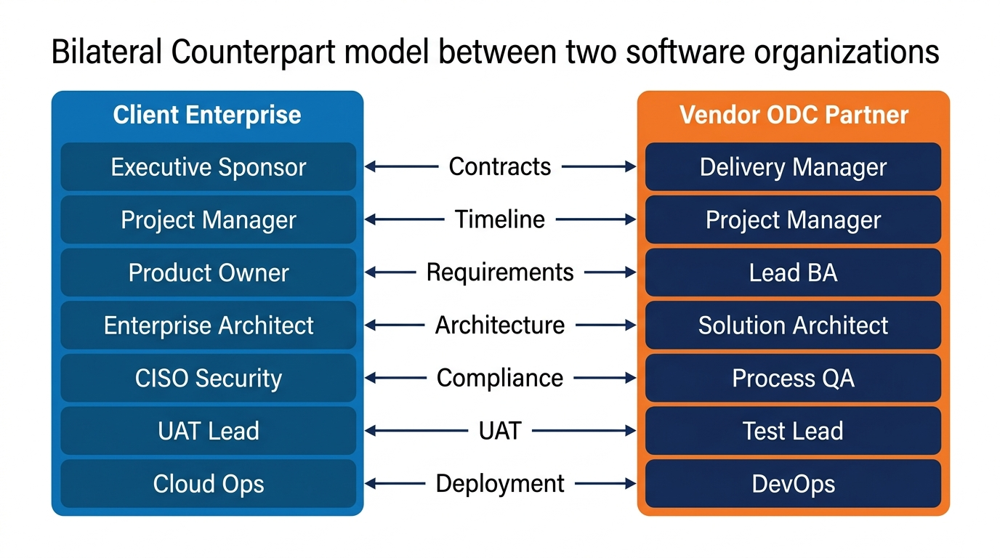
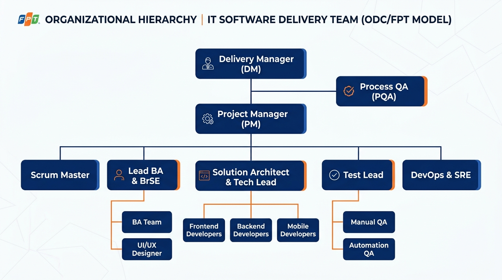
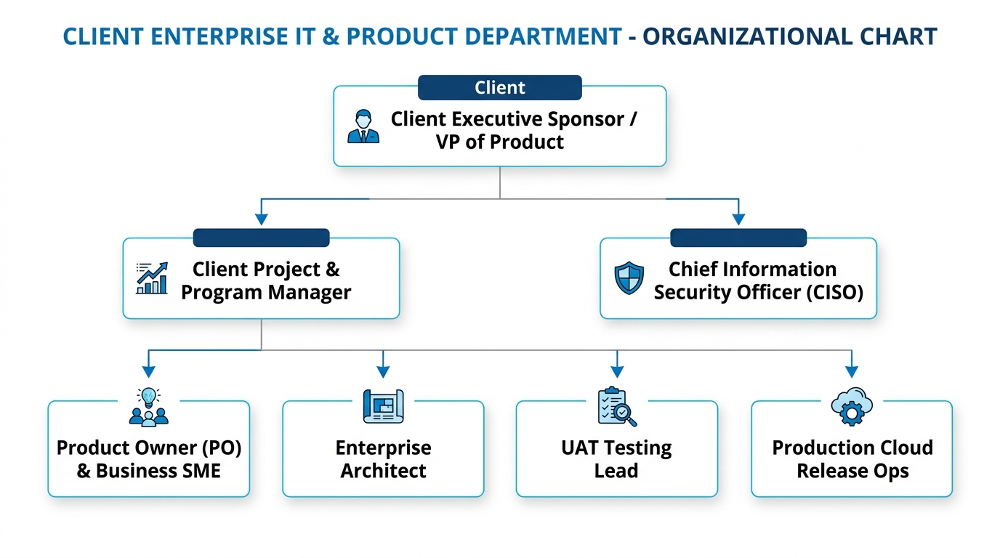

# Phase 02: Requirements Engineering — Enterprise Project Roles & Bilateral Counterpart Model

> **Dự án:** Nexus Platform  
> **Thư mục lưu trữ:** [`docs/02-requirements/roles.md`](file:///e:/Nexus/Nexus/docs/02-requirements/roles.md)  
> **Tài liệu liên quan:** [srs.md](file:///e:/Nexus/Nexus/docs/02-requirements/srs.md), [business-qna-1.md](file:///e:/Nexus/Nexus/docs/02-requirements/qna/business-qna-1.md), [personas.md](file:///e:/Nexus/Nexus/docs/01-business/personas.md)

---

## 1. Sơ đồ Đối ứng Song phương 1-1 (Bilateral Counterpart Model)

Sơ đồ minh họa 7 tầng đối ứng song song trực diện giữa **Doanh nghiệp Khách hàng (Client Enterprise)** và **Đối tác Gia công (Vendor / FPT ODC)**:

### Bảng 7 Tầng Giao tiếp Đối ứng:
1. **Executive Sponsor $\longleftrightarrow$ Delivery Manager:** Thỏa thuận hợp đồng khung, ngân sách dự án và mở rộng quy mô.
2. **Project Manager $\longleftrightarrow$ Project Manager:** Kiểm soát tiến độ Sprint, các mốc quan trọng và phòng ngừa Scope Creep.
3. **Product Owner $\longleftrightarrow$ Lead BA:** Chốt yêu cầu nghiệp vụ, tiêu chí nghiệm thu (AC) và ký Hợp đồng Quyết định (`Decision Contract`).
4. **Enterprise Architect $\longleftrightarrow$ Solution Architect:** Phê duyệt kiến trúc kỹ thuật, thiết kế CSDL và chuẩn API.
5. **CISO Security $\longleftrightarrow$ Process QA (PQA):** Kiểm toán an toàn thông tin và phê duyệt quyền khẩn cấp (`Break-glass Approval`).
6. **UAT Lead $\longleftrightarrow$ Test Lead:** Nghiệm thu kịch bản thực tế, xác nhận lỗi (Defects) và đối soát Ma trận RTM.
7. **Cloud Ops $\longleftrightarrow$ DevOps:** Bàn giao gói cài đặt, cấp quyền deploy và giám sát Uptime môi trường Production.

---

## 2. Sơ đồ Cơ cấu Tổ chức Nội bộ Phía Đối tác Gia công (Vendor / FPT ODC)

Sơ đồ cấu trúc cây nhân sự hoàn chỉnh của một ODC phân phối phần mềm:

* **Ban Quản lý:** Delivery Manager (DM) quản lý Project Manager (PM); bộ phận Process QA (PQA) độc lập giám sát quy trình chuẩn quốc tế.
* **Các Trưởng nhóm bộ phận:** Scrum Master, Lead BA & BrSE, Solution Architect & Tech Lead, Test Lead, DevOps & SRE.
* **Đội ngũ Thực thi:** UI/UX Designer, Frontend / Backend / Mobile Developers, Manual & Automation QA Testers.

---

## 3. Sơ đồ Cơ cấu Tổ chức Nội bộ Phía Doanh nghiệp Khách hàng (Client Enterprise)

Sơ đồ bộ máy nhân sự công nghệ và nghiệp vụ phía Khách hàng doanh nghiệp:

* **Ban Lãnh đạo Khách hàng:** Client Executive Sponsor / VP of Product.
* **Cấp Quản lý & An ninh:** Client Project & Program Manager và Chief Information Security Officer (CISO).
* **Đội ngũ Vận hành Nghiệp vụ & Kỹ thuật:**
  * **Product Owner (PO) & Business SME:** Nắm giữ logic nghiệp vụ và ký duyệt phạm vi.
  * **Enterprise Architect:** Đảm bảo hệ thống tuân thủ kiến trúc công nghệ toàn diện của khách hàng.
  * **UAT Testing Lead:** Chủ trì đợt kiểm thử chấp nhận người dùng thực tế.
  * **Production Cloud Release Ops:** Quản trị tài khoản đám mây và mở cổng Release lên Production.

---

## 4. Ứng dụng Thực tế vào Hệ thống Nexus Platform

Cấu trúc đối ứng 7 tầng này giải quyết triệt để các bài toán trong [business-qna-1.md](file:///e:/Nexus/Nexus/docs/02-requirements/qna/business-qna-1.md):

1. **Phân quyền Ký duyệt Chính xác (Authorization Scope):**
   - Chỉ **Client PO** được quyền ký chốt Scope / Feature.
   - Chỉ **Client Architect** được duyệt các điều chỉnh kỹ thuật (Timeout, Database, Architecture).
   - Chỉ **Client CISO** được cấp quyền mở khóa Break-glass Access khi xảy ra sự cố production.
2. **Ngăn chặn Ô nhiễm Thông tin (Noise Isolation):**
   - Các cuộc trao đổi nội bộ của đội kỹ thuật Vendor (Dev $\leftrightarrow$ QC $\leftrightarrow$ DevOps) diễn ra trong **Kênh Nội bộ (Delivery Private Channel)**, không làm phiền Khách hàng.
   - Chỉ khi nào có sự đồng thuận, BA/Tech Lead mới tổng hợp thành **Decision Summary** đưa lên **Project Common Hub** để phía Khách hàng duyệt.
