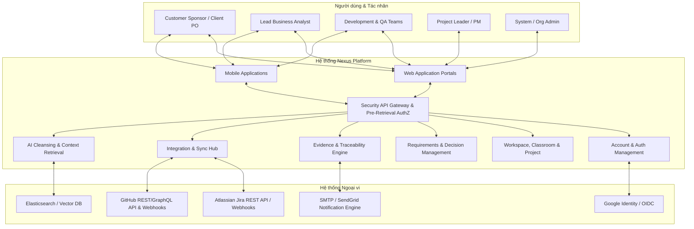
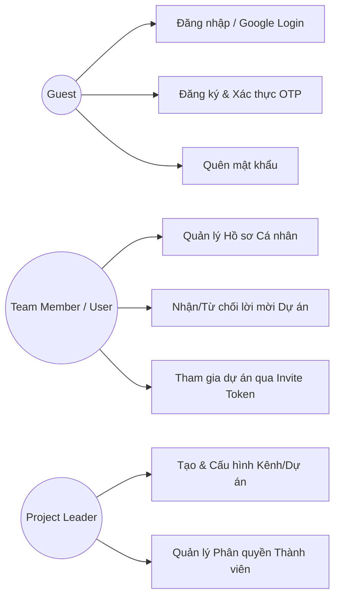
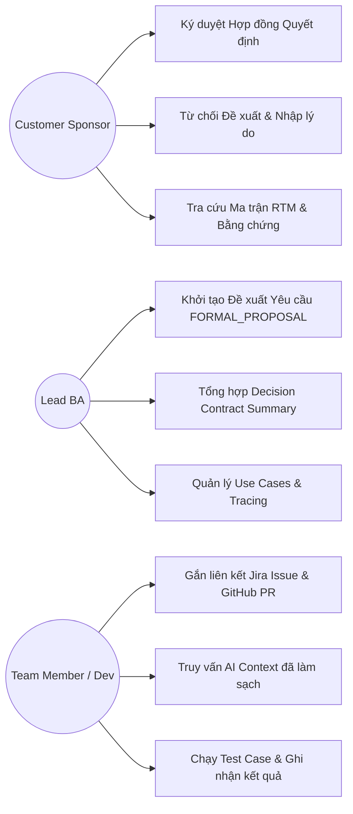
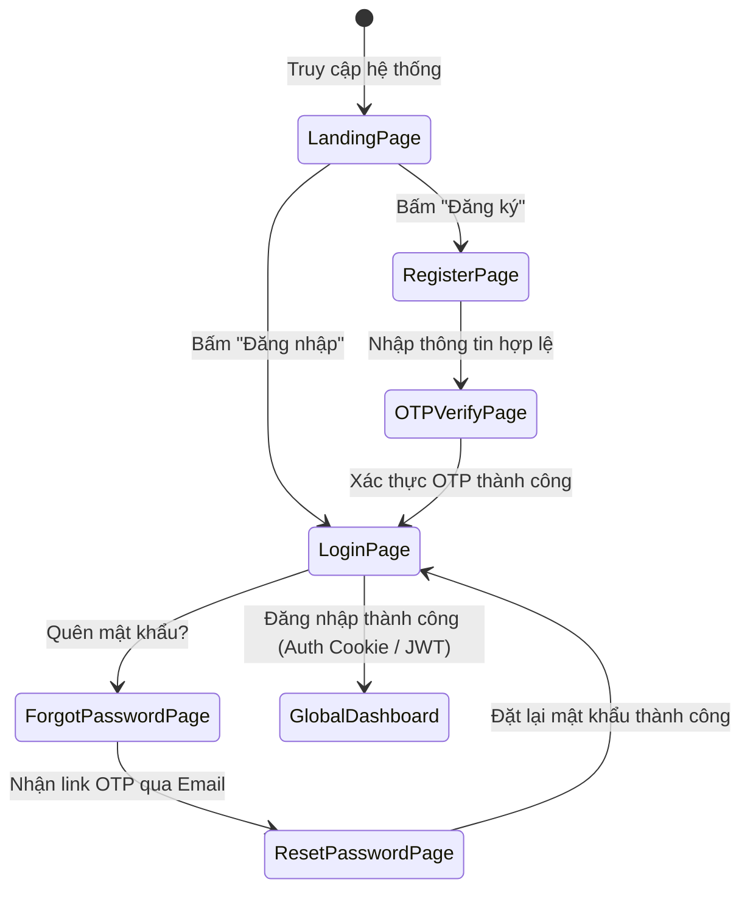
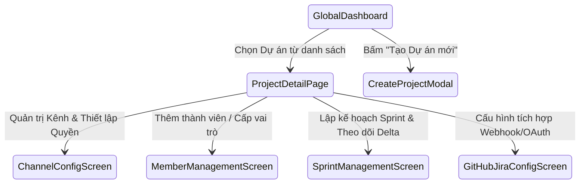
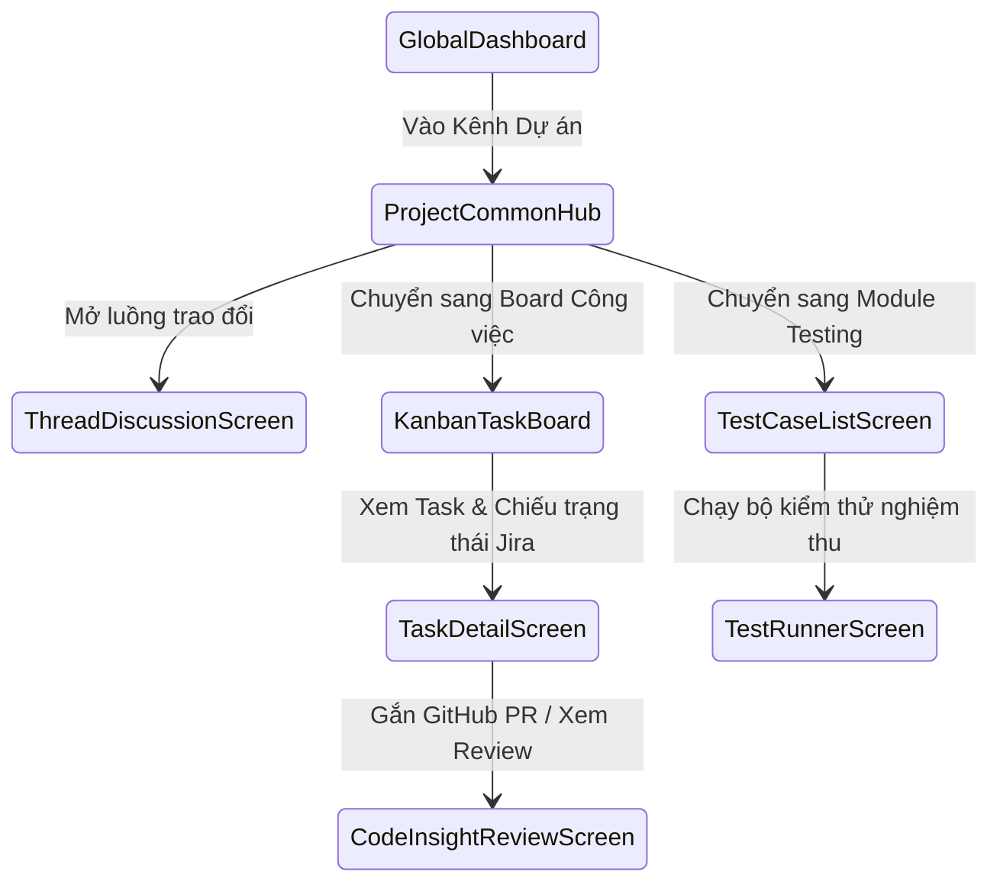
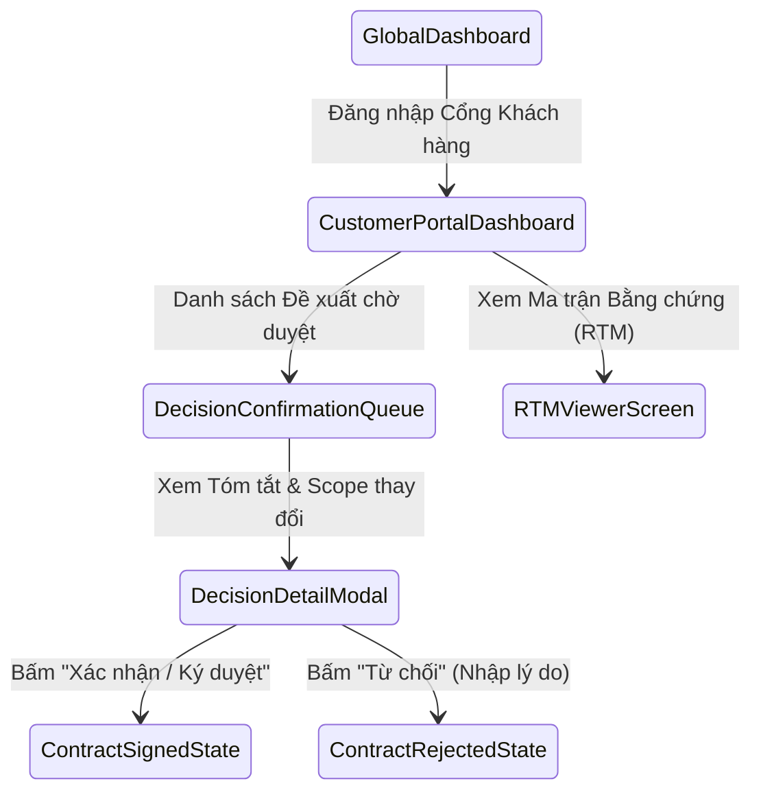
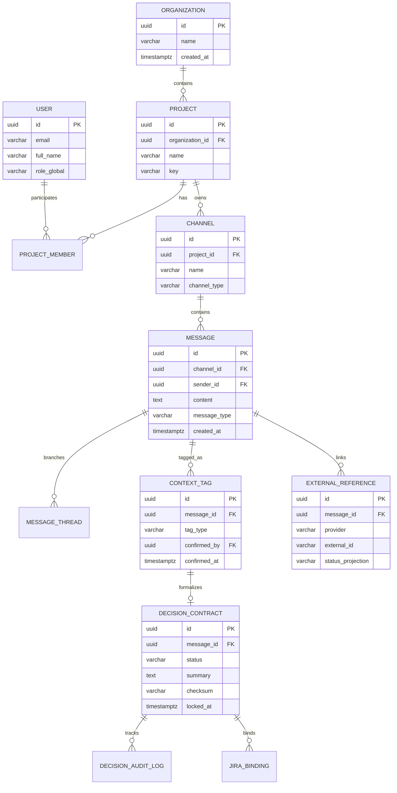

# Software Requirement Specification (SRS) — Nexus Platform

# I. Record of Changes

| Date | Version | Description | Author | Approved By |
| :--- | :--- | :--- | :--- | :--- |
| 15/10/2026 | 1.0 | Khởi tạo tài liệu đặc tả yêu cầu phần mềm chuẩn theo khung SRS cho Nexus Platform | Business Analyst Team | Project Manager / Client Sponsor |
| 15/10/2026 | 1.1 | Cập nhật cấu trúc chi tiết, quy trình ký duyệt bất biến, cơ chế cách ly nhiễu và ma trận kiểm soát màn hình | Minh (Lead BA) & Dat (PM) | Sarah (Customer Sponsor) |

---

# II. Software Requirement Specification

## 1. Product Overview

Nexus là một nền tảng quản lý cộng tác và cầu nối ngữ cảnh dự án doanh nghiệp (**Project Context Bridge**), được thiết kế đặc thù cho các môi trường phân phối phần mềm phân tán (ví dụ: Khách hàng US $\leftrightarrow$ ODC Vietnam $\leftrightarrow$ Đối tác thứ 3).

Trong các dự án phần mềm quy mô lớn, ngữ cảnh nghiệp vụ thường xuyên bị phân mảnh qua nhiều kênh chat (Slack/Discord), email, cuộc họp, Jira ticket và GitHub Pull Requests. Nexus đóng vai trò là **nguồn chân lý tối thượng về ngữ cảnh quyết định** (*Why*, *Who*, *When*, *What*), liên kết chặt chẽ với:
- **Jira:** Quản lý hạng mục công việc (Work Items & Issues).
- **GitHub:** Quản lý mã nguồn và Pull Requests (Source Code & PRs).
- **AI Context & Knowledge Engine:** Làm sạch dữ liệu, khử nhiễu từ các cuộc trò chuyện tự do để cung cấp tri thức chính xác, có thể truy vết về bằng chứng phê duyệt gốc.

### 1.1 Context Diagram

---

## 2. User Requirements

### 2.1 Actors

> Xem chi tiết sơ đồ cơ cấu tổ chức dự án IT và luồng phối hợp liên vai trò tại: [`docs/02-requirements/roles.md`](file:///e:/Nexus/Nexus/docs/02-requirements/roles.md)

| Mã Actor | Tên Tác nhân | Vai trò & Thẩm quyền trong Nexus |
| :--- | :--- | :--- |
| **ACT-01** | **Guest / Unregistered User** | Người dùng vãng lai, xem trang giới thiệu, đăng ký tài khoản, xác thực OTP, hoặc đăng nhập qua Google/GitHub. |
| **ACT-02** | **Customer Sponsor / Client PO** | Đại diện phía khách hàng, có thẩm quyền cao nhất trong việc ký duyệt (`Sign/Confirm`) hoặc từ chối (`Reject`) các đề xuất yêu cầu, theo dõi RTM và báo cáo tiến độ. |
| **ACT-03** | **Project Leader / Project Manager (PM)** | Quản lý dự án, cấu hình kênh/workspace, phân quyền thành viên, quản lý Sprint, giải quyết xung đột phạm vi và giám sát luồng đề xuất. |
| **ACT-04** | **Lead Business Analyst (BA)** | Người tiếp nhận yêu cầu, phân tích, khởi tạo các `FORMAL_PROPOSAL`, tổng hợp `Decision Summary`, quản lý Use Cases và Test Scenarios. |
| **ACT-05** | **Team Member (Developer / QA Engineer)** | Triển khai mã nguồn hoặc viết kiểm thử; xem yêu cầu đã khóa, liên kết Jira Ticket/GitHub PR, cập nhật trạng thái Task và gửi yêu cầu Review Code Insight. |
| **ACT-06** | **Organization / System Admin** | Quản trị toàn cục hệ thống, quản lý tenant, kích hoạt tích hợp OAuth, kiểm toán bảo mật và phê duyệt quyền khẩn cấp (*Break-glass Access*). |

### 2.2 Use Cases

#### 2.2.1 Diagram(s)

##### Sơ đồ Use Case 1: Quản lý Tài khoản & Không gian Làm việc (Account & Workspace)

##### Sơ đồ Use Case 2: Quản lý Yêu cầu, Quyết định & Đối soát (Requirements & Traceability)

#### 2.2.2 Descriptions

| Mã Use Case | Tên Use Case | Tác nhân chính | Mô tả vắn tắt |
| :--- | :--- | :--- | :--- |
| **UC-AUTH-01** | Đăng nhập hệ thống | Guest, User | Xác thực người dùng bằng Email/Password hoặc Google/GitHub OAuth. |
| **UC-AUTH-02** | Đăng ký & Xác thực OTP | Guest | Nhập thông tin, nhận mã OTP qua Email và kích hoạt tài khoản. |
| **UC-WS-01** | Tạo & Cấu hình Project / Channel | Project Leader | Thiết lập Workspace, phân loại Kênh chung (`Project Common Hub`), Kênh riêng tư. |
| **UC-WS-02** | Tham gia qua Token / Lời mời | Team Member | Nhận thư mời hoặc nhập token bí mật để vào dự án/lớp học. |
| **UC-REQ-01** | Tạo Đề xuất Yêu cầu (`FORMAL_PROPOSAL`) | Lead BA / PM | Đánh dấu hoặc tạo thread yêu cầu chính thức từ luồng trao đổi chung. |
| **UC-REQ-02** | Ký duyệt Hợp đồng Quyết định | Customer Sponsor | Phê duyệt bản tổng hợp; hệ thống đóng băng nội dung, cấp Checksum bất biến. |
| **UC-REQ-03** | Từ chối Đề xuất (`Reject Flow`) | Customer Sponsor | Khách hàng từ chối kèm lý do bắt buộc; hệ thống chuyển `REJECTED` và khóa sau 10 ngày. |
| **UC-SYNC-01** | Liên kết 2 chiều với Jira & GitHub | Dev / BA / PM | Gắn mã `NEX-xxx` hoặc PR link; Nexus tự động đồng bộ trạng thái projection. |
| **UC-AI-01** | Làm sạch & Truy xuất tri thức AI | All Authorized Users | AI Agent lọc bỏ tán gẫu (`INFORMAL_CHAT`), trích xuất quyết định kèm liên kết đối soát. |
| **UC-TRAC-01** | Tra cứu Ma trận Truy vết (RTM) | All Members | Xem luồng từ Yêu cầu $\rightarrow$ Quyết định Khách hàng $\rightarrow$ Jira $\rightarrow$ GitHub PR $\rightarrow$ Test Case. |

---

## 3. Functional Requirements

### 3.1 System Functional Overview

#### 3.1.1 Screens Flow

##### 3.1.1.1 Screen Flow of Guest/User

##### 3.1.1.2 Screen Flow of Project Leader

##### 3.1.1.3 Screen Flow of Team Member

##### 3.1.1.4 Screen Flow of Customer Sponsor

#### 3.1.2 Screen Descriptions
1. **Landing Page:** Giới thiệu nền tảng Nexus, tài liệu API, các tính năng nổi bật và nút chuyển hướng Login/Register.
2. **Login / Register / OTP Screens:** Giao diện xác thực tối giản, hỗ trợ Google OAuth 2.0, tự động chặn Brute-force qua CAPTCHA và Rate Limiting.
3. **Global Dashboard:** Hiển thị tổng quan các tổ chức, dự án đang tham gia, thông báo mới nhất và các đầu việc cần xử lý.
4. **Project Common Hub:** Kênh trao đổi trực quan, phân tách rõ ràng tin nhắn tán gẫu với các thread đề xuất quyết định quan trọng.
5. **Decision Modal & Sign Off Workspace:** Màn hình dành riêng cho khách hàng xem xét các thay đổi về Scope/Timeout/Logic, đính kèm nút ký số và lịch sử kiểm toán.
6. **RTM Traceability Matrix Screen:** Bảng lưới ma trận đối soát cho phép lọc đa chiều giữa Requirements, Jira Issues, GitHub PRs và Test Cases.

#### 3.1.3 Screen Authorization

| Màn hình | Guest | Team Member | Lead BA | Project Leader | Customer Sponsor | Org Admin |
| :--- | :---: | :---: | :---: | :---: | :---: | :---: |
| **Landing & Auth Pages** | Toàn quyền | Xem/Sửa | Xem/Sửa | Xem/Sửa | Xem/Sửa | Toàn quyền |
| **Global Dashboard** | ❌ | Xem | Xem | Xem | Xem | Toàn quyền |
| **Project Common Hub** | ❌ | Xem / Chat | Toàn quyền | Toàn quyền | Xem / Chat | Toàn quyền |
| **Private Sub-Channels** | ❌ | Chỉ xem kênh nội bộ | Theo phân quyền | Toàn quyền | ❌ (Cách ly) | Audit Read |
| **Decision Review & Sign** | ❌ | Chỉ đọc | Tạo / Tổng hợp | Quản trị | **Ký / Từ chối** | Audit Read |
| **Kanban & Issue Tracker** | ❌ | Xem / Bind PR | Xem / Link Jira | Cấu hình | Xem tổng hợp | Toàn quyền |
| **Project Integration Settings**| ❌ | ❌ | ❌ | Toàn quyền | ❌ | Toàn quyền |

#### 3.1.4 Non-Screen Functions
- **NFS-01 (Pre-Retrieval Authorization Interceptor):** Tự động chặn mọi yêu cầu truy xuất dữ liệu nếu người dùng không có quyền trong Channel/Project trước khi lệnh SQL được gửi đến CSDL.
- **NFS-02 (Decision Inactivity Auto-Lock Worker):** Dịch vụ chạy ngầm định kỳ quét các thread bị `REJECTED` hoặc không hoạt động quá 10 ngày để chuyển trạng thái sang `LOCKED_READONLY`.
- **NFS-03 (Jira/GitHub Webhook Ingestion Pipeline):** Bộ đệm nhận sự kiện webhook, xác thực khóa chữ ký (HMAC SHA-256), đảm bảo tính Idempotency và cập nhật trạng thái chiếu (Status Projection).
- **NFS-04 (AI Data Sanitizer & Vector Indexer):** Tự động lọc sạch nhiễu từ các tin nhắn tán gẫu thường nhật, chỉ nhúng các quyết định chính thức đã xác nhận vào kho lưu trữ vector ngữ nghĩa.

#### 3.1.5 Entity Relationship Diagram

---

### 3.2 User Account Management & Authentication

#### 3.2.1 Login
- **Mã:** `FR-AUTH-01`
- **Mô tả:** Cho phép người dùng đăng nhập vào Nexus bằng Email và Mật khẩu.
- **Tiêu chí chấp nhận:**
  - Kiểm tra mật khẩu mã hóa bằng thuật toán `Argon2id` hoặc `Bcrypt`.
  - Trả về mã lỗi khi thông tin không khớp; sau 5 lần nhập sai liên tiếp, khóa tài khoản tạm thời trong 15 phút.
  - Cấp phát Access Token (JWT thời hạn ngắn 15 phút) và Refresh Token (HTTP-Only Secure Cookie, thời hạn 7 ngày).

#### 3.2.2 Register Account and Verify OTP
- **Mã:** `FR-AUTH-02`
- **Mô tả:** Người dùng nhập Email hợp lệ, Tên đầy đủ và Mật khẩu (tối thiểu 8 ký tự, bao gồm chữ hoa, chữ thường, số và ký tự đặc biệt). Hệ thống gửi mã OTP gồm 6 chữ số có hiệu lực trong 5 phút về Email. Sau khi nhập đúng OTP, tài khoản được kích hoạt ở trạng thái `ACTIVE`.

#### 3.2.3 Sign in with Google
- **Mã:** `FR-AUTH-03`
- **Mô tả:** Tích hợp Google OAuth 2.0 / OIDC. Khi người dùng đăng nhập bằng Google, hệ thống tự động đối soát email: nếu chưa tồn tại, tự động tạo tài khoản với vai trò mặc định `TEAM_MEMBER`; nếu đã tồn tại, đồng bộ định danh liên kết.

#### 3.2.4 Sign Out
- **Mã:** `FR-AUTH-04`
- **Mô tả:** Hủy phiên làm việc hiện tại, thu hồi Refresh Token trên Redis Token Blacklist, xóa toàn bộ cookie xác thực ở Client.

#### 3.2.5 Forgot Password
- **Mã:** `FR-AUTH-05`
- **Mô tả:** Cho phép người dùng yêu cầu đặt lại mật khẩu bằng cách gửi email chứa Reset Token bí mật (hiệu lực 15 phút). Không tiết lộ thông tin email có tồn tại trên hệ thống hay không để ngăn chặn kỹ thuật trinh sát tài khoản (User Enumeration).

#### 3.2.6 Change Password
- **Mã:** `FR-AUTH-06`
- **Mô tả:** Người dùng đã đăng nhập có thể đổi mật khẩu mới bằng cách cung cấp mật khẩu hiện tại và mật khẩu mới. Sau khi đổi thành công, hệ thống tự động đăng xuất tất cả các phiên làm việc khác.

#### 3.2.7 Profile Management
- **Mã:** `FR-AUTH-07`
- **Mô tả:** Cho phép người dùng cập nhật ảnh đại diện (Avatar), Họ tên, Chức danh, Số điện thoại và Múi giờ làm việc (phục vụ đối soát giờ làm việc đa quốc gia US-VN).

#### 3.2.8 GitHub OAuth Callback
- **Mã:** `FR-AUTH-08`
- **Mô tả:** Xử lý xác thực liên kết tài khoản GitHub của lập trình viên để cấp quyền đọc Pull Request, Commit Hash và trạng thái đóng góp mã nguồn.

---

### 3.3 Workspace, Classroom & Project Management

#### 3.3.1 Global Dashboard
- **Mã:** `FR-WS-01`
- **Mô tả:** Bảng điều khiển trung tâm hiển thị: Danh sách Dự án / Lớp học (Classroom / Project Cohorts) đang hoạt động, Bộ lọc theo Organization, Số lượng yêu cầu đang chờ phê duyệt và Lịch sử truy cập gần đây.

#### 3.3.2 Accept or Reject Project Invitation
- **Mã:** `FR-WS-02`
- **Mô tả:** Khi được thêm vào Dự án, người dùng nhận được thông báo kèm nút "Chấp nhận" hoặc "Từ chối". Quyền truy cập các kênh chỉ có hiệu lực sau khi người dùng xác nhận tham gia.

#### 3.3.3 Classroom List
- **Mã:** `FR-WS-03`
- **Mô tả:** Hiển thị danh mục các nhóm dự án/lớp học đào tạo thực tập (dành cho mô hình ODC/Capstones), bao gồm mã định danh, người hướng dẫn/Leader, ngày bắt đầu và trạng thái hoạt động.

#### 3.3.4 Join Classroom by Invite Token
- **Mã:** `FR-WS-04`
- **Mô tả:** Cho phép người dùng tham gia vào Dự án/Lớp học bằng mã Token bí mật được sinh bởi Project Leader. Mã có thể được cấu hình số lượng lần sử dụng hoặc thời hạn hết hạn.

#### 3.3.5 Classroom Detail
- **Mã:** `FR-WS-05`
- **Mô tả:** Trang chi tiết dự án bao gồm: Danh sách kênh (Public, Private, Project Common Hub), Thiết lập mô hình khởi tạo đề xuất (Mô hình BA trung tâm vs Mô hình Mở), và danh sách tích hợp bên ngoài.

#### 3.3.6 Member Management
- **Mã:** `FR-WS-06`
- **Mô tả:** Project Leader có thể phân bổ vai trò trong dự án: `Project Leader`, `Lead BA`, `Developer`, `QA Engineer`, `Customer Sponsor`.

#### 3.3.7 Contribution Page
- **Mã:** `FR-WS-07`
- **Mô tả:** Trang thống kê đóng góp của từng thành viên: Số lượng tin nhắn ngữ cảnh, số đề xuất được khởi tạo, số lượng Task Jira và PR GitHub đã hoàn thành gắn với quyết định dự án.

---

### 3.4 Requirements Management

#### 3.4.1 Requirements List and AI Generation
- **Mã:** `FR-REQ-01`
- **Mô tả:**
  - Hiển thị danh sách toàn bộ các yêu cầu chức năng và phi chức năng được phân loại theo Module, Sprint, Trạng thái (`DRAFT`, `PROPOSED`, `CONFIRMED`, `REJECTED`).
  - Hỗ trợ tính năng **AI Generation**: Cho phép BA nạp biên bản họp thô (Meeting Notes/Chat transcript) để AI tự động trích xuất thành danh sách đề xuất yêu cầu có cấu trúc.

#### 3.4.2 Requirement Detail
- **Mã:** `FR-REQ-02`
- **Mô tả:**
  - Hiển thị chi tiết nội dung yêu cầu, Acceptance Criteria (AC), mã Sprint áp dụng, lịch sử thảo luận và đối chiếu với Hợp đồng quyết định.
  - Cho phép Customer Sponsor thực hiện thao tác **1-Click Confirmation** hoặc **Reject với lý do bắt buộc**.
  - Sau khi ký duyệt, nội dung chuyển sang chế độ bất biến (`IMMUTABLE_LOCKED`), mọi thay đổi sau đó phải đi theo quy trình tạo nhánh Delta hoặc Pivot.

#### 3.4.3 AI Staging Review
- **Mã:** `FR-REQ-03`
- **Mô tả:** Vùng đệm rà soát cho Lead BA xem trước các yêu cầu do AI gợi ý từ kênh chat. BA có thể chỉnh sửa, gộp, loại bỏ tin rác trước khi đưa lên luồng đề xuất chính thức (`FORMAL_PROPOSAL`).

---

### 3.5 Use Case Management

#### 3.5.1 Use Case List and UC Diagram
- **Mã:** `FR-UC-01`
- **Mô tả:**
  - Danh mục quản lý tất cả các Use Case của hệ thống, nhóm theo Actor và Bounded Context.
  - Tự động sinh sơ đồ PlantUML / Mermaid Use Case Diagram trực tiếp từ danh mục yêu cầu đã phê duyệt.

#### 3.5.2 Use Case Detail
- **Mã:** `FR-UC-02`
- **Mô tả:** Đặc tả chi tiết từng Use Case gồm: Tiền điều kiện (Pre-conditions), Hậu điều kiện (Post-conditions), Luồng sự kiện chính (Basic Flow), Luồng phụ (Alternative Flow), Luồng ngoại lệ (Exception Flow) và liên kết chéo tới Test Case.

---

### 3.6 Sprint, Kanban & Task Management

#### 3.6.1 Kanban Task Board
- **Mã:** `FR-TASK-01`
- **Mô tả:**
  - Bảng Kanban trực quan phản ánh trạng thái công việc được đồng bộ từ Jira Cloud (To Do, In Progress, Code Review, Testing, Done).
  - Tích hợp nhãn cảnh báo: Ticket nào đã có `Nexus-Contract-ID` hợp lệ từ khách hàng và ticket nào là ticket "mồ côi" (nguy cơ phình to phạm vi / Scope Creep).

#### 3.6.2 Task Detail
- **Mã:** `FR-TASK-02`
- **Mô tả:** Hiển thị chi tiết Task, liên kết trực tiếp tới tin nhắn thỏa thuận gốc trong Nexus, thông tin người giao, người nhận, độ ưu tiên và URL Jira gốc.

#### 3.6.3 My Tasks Daily and Weekly View
- **Mã:** `FR-TASK-03`
- **Mô tả:** Chế độ xem cá nhân hóa cho từng kỹ sư và tester, lọc các đầu việc cần làm trong ngày và trong tuần, tổng hợp thời gian cập nhật gần nhất từ Jira và GitHub.

#### 3.6.4 Sprint Management
- **Mã:** `FR-TASK-04`
- **Mô tả:**
  - Quản lý danh sách các Sprint, mốc bắt đầu - kết thúc, mục tiêu Sprint (Sprint Goal).
  - Xử lý các thay đổi yêu cầu phát sinh trong Sprint theo sơ đồ quyết định:
    - Nếu ticket chưa làm: Cập nhật trực tiếp kèm tag `[Update DD/MM]`.
    - Nếu thay đổi một phần (Delta < 100%): Khởi tạo ticket mở rộng với liên kết `relates to` hoặc `is extended by`.
    - Nếu thay đổi toàn diện (Pivot 100%): Tạo ticket mới thay thế với liên kết `supersedes`, đóng băng ticket cũ.

---

### 3.7 Testing Module

#### 3.7.1 Test Case List
- **Mã:** `FR-TEST-01`
- **Mô tả:** Danh sách các ca kiểm thử nghiệm thu (Acceptance Test Cases), liên kết trực tiếp với từng Acceptance Criteria (AC) trong User Story.

#### 3.7.2 Test Case Detail and Live Runner
- **Mã:** `FR-TEST-02`
- **Mô tả:**
  - Xem chi tiết các bước kiểm thử (Steps, Test Data, Expected Outcome).
  - Công cụ **Live Runner**: Cho phép QA ghi nhận kết quả kiểm thử thực tế (Passed, Failed, Blocked), đính kèm ảnh chụp bằng chứng lỗi và tự động kích hoạt tạo Bug trên Jira Issue Tracker.

---

### 3.8 Evidence & Traceability Management

#### 3.8.1 Evidence List
- **Mã:** `FR-TRAC-01`
- **Mô tả:** Kho lưu trữ tập trung tất cả các bằng chứng phê duyệt (Customer Confirmations), các biên bản hợp đồng quyết định (`Decision Contracts`) và các bản ghi sự kiện bảo mật.

#### 3.8.2 Evidence Detail
- **Mã:** `FR-TRAC-02`
- **Mô tả:**
  - Hiển thị bản chụp dữ liệu tại thời điểm phê duyệt, mã định danh người ký (Customer ID), dấu thời gian chuẩn UTC.
  - Chữ ký mã hóa xác thực (**Cryptographic Checksum** - SHA-256) chứng minh tính toàn vẹn và chống chối bỏ.

#### 3.8.3 Requirements Traceability Matrix
- **Mã:** `FR-TRAC-03`
- **Mô tả:** Bảng ma trận đối soát toàn diện (RTM) thể hiện mối liên kết xuyên suốt 5 tầng dữ liệu:  
  $$\text{Business Goal} \longrightarrow \text{Requirement (US)} \longrightarrow \text{Customer Decision} \longrightarrow \text{Jira/GitHub} \longrightarrow \text{Test Case Result}$$

---

### 3.9 Code Insight Review Management

#### 3.9.1 Task Review Dashboard / Code Insight Queue
- **Mã:** `FR-CODE-01`
- **Mô tả:** Hàng đợi tập trung các Pull Request đang chờ đánh giá (Review) được đồng bộ từ GitHub, hiển thị trạng thái CI/CD (Checks Passed/Failed), số lượng comment và người được chỉ định review.

#### 3.9.2 Task Review Workspace / Code Insight Review
- **Mã:** `FR-CODE-02`
- **Mô tả:** Cho phép lập trình viên và Tech Lead xem ngữ cảnh quyết định yêu cầu gốc ngay bên cạnh giao diện so sánh mã nguồn (Diff View), đảm bảo mã triển khai không làm lệch ý đồ ban đầu của khách hàng.

---

### 3.10 Issue Tracker & GitHub Integration

#### 3.10.1 Issue Tracker Dashboard
- **Mã:** `FR-INT-01`
- **Mô tả:** Bảng tổng hợp các vấn đề phát sinh (Bugs, Impediments, Tech Debts), hỗ trợ lọc theo Provider (`JIRA`, `GITHUB_ISSUES`, `NEXUS_NATIVE`).

#### 3.10.2 Issue Detail View
- **Mã:** `FR-INT-02`
- **Mô tả:** Xem chi tiết vấn đề kèm chiếu trạng thái động từ hệ thống ngoài; không cho phép sửa trực tiếp các trường do Jira làm chủ sở hữu để tuân thủ nguyên tắc Single Source of Truth.

#### 3.10.3 Feature Discussion
- **Mã:** `FR-INT-03`
- **Mô tả:** Không gian thảo luận chuyên biệt cho từng tính năng. Áp dụng cơ chế phân tách: Mọi ý kiến thông thường mang nhãn `INFORMAL_CHAT`; chỉ những thỏa thuận đồng thuận sau thảo luận mới được Lead BA đóng gói thành đề xuất ràng buộc.

#### 3.10.4 Project GitHub Configuration
- **Mã:** `FR-INT-04`
- **Mô tả:** Giao diện cho phép Project Leader nhập GitHub Repository URL, Webhook Secret, và phân quyền cho GitHub App của Nexus đọc dữ liệu repository.

---

### 3.11 Reporting, Notifications & Feedback

#### 3.11.1 Sprint Report
- **Mã:** `FR-REP-01`
- **Mô tả:** Tự động tổng hợp báo cáo tiến độ Sprint bao gồm: Số lượng yêu cầu đã xác nhận, tỷ lệ thay đổi phạm vi (Scope Delta), số giờ tiết kiệm được trong truy vết ngữ cảnh và danh sách các quyết định còn tồn đọng.

#### 3.11.2 Notifications
- **Mã:** `FR-NOTI-01`
- **Mô tả:** Hệ thống thông báo đa kênh (Real-time In-App Push, WebSocket badge, và Email thông báo):
  - Thông báo ngay cho Customer khi có Đề xuất mới cần ký duyệt.
  - Tự động Broadcast thông báo đến `Project Common Hub` và các đội ngũ liên quan (Backend, QA) ngay khi Khách hàng hoàn tất ký xác nhận.

#### 3.11.3 Not Found Page
- **Mã:** `FR-ERR-01`
- **Mô tả:** Giao diện xử lý lỗi điều hướng chuẩn (HTTP 404 / 403), hiển thị thông điệp thân thiện và nút điều hướng nhanh về Global Dashboard.

---

## 4. Non-Functional Requirements

### 4.1 External Interfaces

#### 4.1.1 User Interfaces
- Giao diện người dùng trên nền Web xây dựng theo chuẩn Responsive Design, hỗ trợ các trình duyệt hiện đại (Chrome, Edge, Firefox, Safari).
- Hỗ trợ giao diện tối/sáng (Dark/Light mode), tối ưu hiển thị thông tin dạng bảng đối soát mật độ cao và typography rõ ràng.
- Giao diện ứng dụng di động (Mobile App) tập trung vào tính năng: Nhận thông báo đẩy, Đọc thread thảo luận và Ký duyệt nhanh (1-Click Approval) dành cho Customer Sponsor.

#### 4.1.2 Software Interfaces
- **Atlassian Jira REST API v3:** Tích hợp đọc issue metadata, cập nhật custom field `Nexus-Contract-ID` và nhận Webhook sự kiện thay đổi trạng thái.
- **GitHub REST & GraphQL API v4:** Tích hợp đồng bộ trạng thái Pull Request, Commit sha và CI Checks.
- **Google Identity Platform:** Xác thực SSO dựa trên chuẩn OpenID Connect (OIDC).
- **PostgreSQL 16+:** Cơ sở dữ liệu quan hệ lưu trữ thực thể nghiệp vụ, audit trail và trạng thái hợp đồng.
- **Redis 7+:** Quản lý hàng đợi tin nhắn thời gian thực, lưu trữ session và phân tán Rate Limiter.
- **Elasticsearch / Vector DB:** Phục vụ tìm kiếm toàn văn và truy xuất ngữ cảnh cho AI Agent.

### 4.2 Quality Attributes

#### 4.2.1 Usability
- Thời gian làm quen cho người dùng mới (đặc biệt là Khách hàng duyệt yêu cầu) < 15 phút.
- Thao tác ký duyệt hoặc từ chối đề xuất được hoàn tất trong tối đa 2 lần nhấp chuột từ thông báo.

#### 4.2.2 Security
- **Pre-Retrieval Authorization:** Mọi truy vấn đọc dữ liệu hoặc tìm kiếm AI phải kiểm tra quyền của người dùng tại tầng Gateway/Service trước khi thực thi lệnh truy vấn dữ liệu.
- **Multi-Tenant Isolation:** Đảm bảo ngăn cách tuyệt đối giữa các tổ chức (Organization/Tenant), không xảy ra rò rỉ dữ liệu chéo ở cấp độ API, Cache và Database.
- **Bất biến & Chống chối bỏ (Non-Repudiation):** Mọi hành động xác nhận của khách hàng được gắn kèm chữ ký mã hóa, dấu thời gian UTC và không thể chỉnh sửa hoặc xóa bỏ.
- **Mật khẩu & Mã hóa:** Mã hóa toàn bộ dữ liệu khi truyền tải (TLS 1.3) và khi lưu trữ (AES-256).

#### 4.2.3 Performance
- Thời gian trễ phân phối tin nhắn thời gian thực (P95) qua WebSocket < **150ms**.
- Thời gian đáp ứng các truy vấn tìm kiếm tri thức có phân quyền (P99) < **500ms**.
- Hệ thống hỗ trợ tối thiểu 10.000 kết nối đồng thời trên mỗi cụm máy chủ Messaging.

#### 4.2.4 Reliability
- Cam kết thời gian hoạt động ổn định (Availability SLO) đạt **99.9%**.
- Cơ chế xử lý Webhook Idempotency đảm bảo khi Jira/GitHub gửi lặp sự kiện, Nexus không bị ghi nhận trùng lặp dữ liệu.
- Cơ chế tự động khóa đọc (`LOCKED_READONLY`) các thread sau 10 ngày không hoạt động.

#### 4.2.5 Maintainability
- Cấu trúc hệ thống theo mô hình **Modular Monolith** kết hợp Domain-Driven Design (DDD), phân chia rõ ranh giới Bounded Contexts.
- Tỷ lệ bao phủ kiểm thử tự động (Unit Test & Integration Test) đạt tối thiểu **80%** cho các module cốt lõi (Auth, Context Engine, Traceability).

#### 4.2.6 Compatibility and Portability
- Tương thích hoàn toàn trên các nền tảng máy tính (Windows, macOS, Linux) và thiết bị di động (iOS, Android).
- Đóng gói toàn bộ ứng dụng dưới dạng Docker Containers, sẵn sàng triển khai trên hạ tầng Kubernetes hoặc Docker Swarm.

#### 4.2.7 Scalability
- Khả năng mở rộng theo chiều ngang (Horizontal Scaling) cho tầng API Gateway và WebSocket Cluster thông qua cơ chế Redis Pub/Sub.

---

## 5. Other Requirements

### 5.1 Business Rules

| Mã Quy tắc | Tên Quy tắc | Nội dung Ràng buộc Nghiệp vụ |
| :--- | :--- | :--- |
| **BR-01** | **Tính Bất biến của Xác nhận (Context Immutability)** | Một khi thông điệp/đề xuất đã được Khách hàng nhấn "Confirm", nội dung sẽ bị đóng băng vĩnh viễn (`IMMUTABLE_LOCKED`). Không ai (kể cả Admin) được quyền xóa hoặc sửa đổi nội dung đã xác nhận. |
| **BR-02** | **Phân quyền Tiền truy xuất (Pre-Retrieval Authorization)** | Quyền truy cập được xác thực ở mức Channel/Project trước khi thực hiện bất kỳ lệnh tìm kiếm hoặc nạp tri thức nào cho AI. |
| **BR-03** | **Ranh giới Nguồn Chân lý (Source of Truth Boundaries)** | Nexus là nguồn chân lý cho Ngữ cảnh Quyết định & Phê duyệt. Jira là nguồn chân lý cho Hạng mục công việc (Work Items). GitHub là nguồn chân lý cho Mã nguồn. Nexus chỉ chiếu trạng thái (Projection) và không ghi đè dữ liệu gốc của Jira/GitHub. |
| **BR-04** | **Phân lập Kênh Nội bộ & Kênh Chung (Cross-Team Isolation)** | Tin nhắn trong Kênh Nội bộ (Private Sub-channels) không bao giờ bị lộ ra ngoài cho Khách hàng. Chỉ những thông tin được gắn thẻ cầu nối (`Bridge to Common Hub`) mới được xuất hiện trên `Project Common Hub`. |
| **BR-05** | **Khử nhiễu Dữ liệu AI (AI Noise Cleansing)** | AI Agent chỉ được phép trích xuất thông tin từ các bản ghi có trạng thái `CONTRACTUAL_CONFIRMATION` hoặc `FORMAL_PROPOSAL`. Toàn bộ tin nhắn `INFORMAL_CHAT` (nói lơi, tán gẫu) bị loại bỏ khỏi ngữ cảnh trả lời. |
| **BR-06** | **Xử lý Sai sót sau Phê duyệt (Post-Confirmation Correction)** | Nếu khách hàng xác nhận nhầm số liệu (ví dụ: bấm nhầm 15s thay vì 1.5s), không được chỉnh sửa bản xác nhận cũ mà phải mở đề xuất mới và tạo Ticket Jira mới liên kết theo quan hệ `supersedes`. |
| **BR-07** | **Bắt buộc Lý do khi Từ chối (Mandatory Reject Reason)** | Khi khách hàng bấm Reject một đề xuất, hệ thống bắt buộc người dùng nhập lý do từ chối (tối thiểu 10 ký tự) mới cho phép hoàn tất giao dịch. |
| **BR-08** | **Thời hạn Đóng băng Tự động (10-Day Auto-Lock)** | Các thread bị từ chối hoặc đã hoàn tất không có tương tác mới sau 10 ngày sẽ tự động khóa chat, chuyển sang chế độ chỉ đọc vĩnh viễn. |

### 5.2 Application Messages List

| Mã Thông báo | Loại | Ngữ cảnh Kích hoạt | Nội dung Thông báo Hiển thị cho Người dùng |
| :--- | :--- | :--- | :--- |
| **MSG-AUTH-001** | Thành công | Đăng ký tài khoản | `Mã xác thực OTP đã được gửi đến email của bạn. Vui lòng kiểm tra hộp thư.` |
| **MSG-AUTH-002** | Lỗi | Đăng nhập sai | `Email hoặc mật khẩu không chính xác. Vui lòng thử lại.` |
| **MSG-AUTH-003** | Cảnh báo | Khóa tài khoản tạm thời | `Bạn đã nhập sai quá 5 lần. Tài khoản tạm khóa trong 15 phút để bảo mật.` |
| **MSG-REQ-001** | Thành công | Gửi đề xuất yêu cầu | `Đề xuất yêu cầu chính thức đã được gửi tới Khách hàng phê duyệt.` |
| **MSG-REQ-002** | Thành công | Khách hàng ký duyệt | `Hợp đồng quyết định đã được xác nhận thành công và đóng băng nội dung.` |
| **MSG-REQ-003** | Cảnh báo | Từ chối đề xuất | `Đề xuất đã bị từ chối. Lý do đã được ghi nhận vào lịch sử đối soát.` |
| **MSG-REQ-004** | Lỗi | Thiếu lý do từ chối | `Vui lòng nhập lý do từ chối cụ thể (tối thiểu 10 ký tự) để đội ngũ tiếp tục điều chỉnh.` |
| **MSG-REQ-005** | Lỗi | Cố ý chỉnh sửa xác nhận | `Hành động bị từ chối: Quyết định đã được xác nhận mang tính bất biến (BR-01).` |
| **MSG-SEC-001** | Lỗi | Không có quyền truy cập | `403 Forbidden: Bạn không có quyền truy cập vào kênh hoặc dự án này.` |
| **MSG-INT-001** | Thành công | Liên kết Jira Issue | `Đã liên kết thành công với Jira Ticket [NEX-xxx]. Trạng thái đối soát đang hoạt động.` |
| **MSG-INT-002** | Cảnh báo | Webhook trùng lặp | `Sự kiện webhook đã được xử lý trước đó (Idempotent Event Skipped).` |
