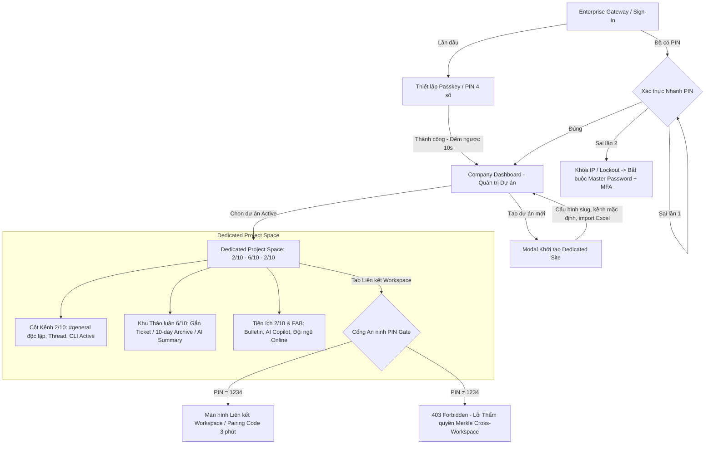

# Phase 02: Requirements Engineering — Nexus Enterprise UI & User Flows Specification

> **Tài liệu tham chiếu:** Kiến trúc giao diện, luồng trải nghiệm người dùng (Core User Flows) và hệ thống màn hình Canvas của nền tảng **Nexus Enterprise**.

---

## 🧭 Kiến trúc Điều hướng & Sơ đồ Tổng thể

---

## I. CÁC LUỒNG HOẠT ĐỘNG CHÍNH (CORE USER FLOWS)

### 1. Luồng Xác thực, Onboarding & Cấu hình Passkey An ninh

#### 1.1. Đăng nhập Ban đầu (Enterprise Gateway / Sign-In)
- **Thiết kế:** Chuẩn Web PC tối giản, bề thế, tập trung trọng tâm vào bảo mật, loại bỏ hoàn toàn thanh điều hướng (nav) thừa.
- **Phương thức hỗ trợ:**
  - Email doanh nghiệp + Mật khẩu quản trị cấp cao (**Master Security Key**).
  - Đăng nhập một lần (**SSO**): Google Workspace, Microsoft 365 Enterprise.

#### 1.2. Thiết lập Passkey / PIN Lần đầu (Post-login First Time)
- **Nhận diện phần cứng tự động:**
  - Web Browser (Desktop/Laptop): Mặc định tạo mã PIN bảo mật 4 chữ số.
  - Thiết bị iOS: Kích hoạt Face ID / Touch ID (WebAuthn).
  - Thiết bị Android: Kích hoạt cảm biến vân tay / Biometrics.
- **Quy trình 2 bước:**
  $$\text{Nhập mã PIN (4 số)} \longrightarrow \text{Xác nhận lại PIN (Re-enter PIN)} \longrightarrow \text{Kích hoạt thành công}$$
- **Điều hướng chuyển tiếp:** Màn hình thông báo kích hoạt thành công kèm **bộ đếm ngược 10 giây** tự động chuyển hướng vào Company Dashboard tổng dự án (hoặc người dùng có thể nhấp *"Vào Dashboard ngay"*).

#### 1.3. Đăng nhập Nhanh các lần tiếp theo (Passkey Fast Auth & Lockout)
- Cho phép xác thực tức thì bằng Passkey/PIN mà không cần gõ lại mật khẩu tài khoản.
- **Cơ chế kiểm soát an ninh nghiêm ngặt:**
  - Giới hạn tối đa **2 lần nhập sai**.
  - Nếu nhập sai lần thứ 2: Hệ thống lập tức kích hoạt **Lockout IP**, tạm khóa quyền truy cập nhanh và ép buộc người dùng quay lại quy trình đăng nhập đầy đủ bằng **Master Password + MFA**.

---

### 2. Luồng Quản trị Doanh nghiệp & Khởi tạo Dự án (Company Dashboard)

#### 2.1. Tổng quan & Danh sách Dự án Hoạt động (Active Projects)
- **Bố cục khung nhìn:**
  - Hệ thống lưới tiêu chuẩn **1200px**, lề an toàn cố định **16px**.
  - **Loại bỏ hoàn toàn sidebar dọc:** Toàn bộ menu con, cài đặt tài khoản, kho lưu trữ được gom gọn gàng vào Profile Dropdown / Sub-menu tại logo *My Info*.
- **Banner thông báo dạng Slide (Announcement Carousel):**
  - Tự động chuyển tiếp chu kỳ **3 giây/slide**.
  - Sắp xếp theo thứ tự mới nhất (*newest*), hiển thị thông báo khẩn từ Admin hệ thống hoặc cảnh báo hợp đồng quan trọng.
- **Danh sách dự án Active:**
  - Trình bày dạng **thanh ngang (Horizontal Rows)** tối giản, thanh thoát.
  - Hiển thị đầy đủ: Tên dự án, đường dẫn slug nội bộ, số lượng nhân sự tham gia và nút truy cập trực tiếp vào không gian làm việc.
- **Chứng chỉ quy chuẩn an ninh:** Chân trang (**Footer**) cố định chứng thực tuân thủ **RFC 3161** (Trusted Timestamping) & **ISO/IEC 27001**.

#### 2.2. Modal Khởi tạo Dedicated Site Dự án Mới
- **Thông tin định danh:**
  - Tên dự án và tiền tố URL chuẩn hóa: `https://[ten-du-an].nexus.com`.
- **Kênh mặc định hệ thống:**
  - Tự động sinh 3 kênh cố định: `#general`, `#project-memory`, `#personal-vault`.
  - Thông báo lưu ý quản trị viên cấu hình phân quyền chi tiết hơn tại mục Insight dự án.
- **Quản lý nhân sự ban đầu:**
  - Hỗ trợ công cụ tìm kiếm nhân sự nội bộ theo phòng ban/email.
  - Hỗ trợ nhập danh sách thành viên cốt lõi hàng loạt thông qua tệp Excel (`.xlsx`, `.csv`).

---

### 3. Luồng Không gian Làm việc Dự án (Dedicated Project Space)

#### 3.1. Bố cục Tổng thể 3 Phân vùng (Tỷ lệ 2/10 – 6/10 – 2/10)
- **Top Navigation ngang:**
  - Chuỗi liên kết điều hướng breadcrumbs: `Homespace > [Tên Dự Án]`.
  - Hệ thống tab chức năng:
    1. *Tổng quan*
    2. *Quyết định & RFC*
    3. *Artifacts & Compliance*
    4. *Đồng bộ Jira/GitHub*
    5. *Nhân sự & Tiến độ*
    6. *Audit Log*
    7. **Liên kết Workspace (Federation)** *(Yêu cầu xác thực cổng an ninh)*

#### 3.2. Cột Kênh Bên Trái (Chiếm 2/10 Màn hình)
- **Phong cách giao diện:** Tối giản hiện đại (tương đồng Discord), lược bỏ viền bao quanh rườm rà.
- **Kênh đặc thù `#general`:**
  - Là trung tâm tổng hợp tất cả các ticket đã được log trong dự án.
  - **Hoàn toàn không có thread con** để tránh phân mảnh luồng thông tin chung.
- **Các kênh thảo luận chuyên đề khác:**
  - Hiển thị tối đa **3 thread đang hoạt động (active)** kèm nút mở rộng "Xem thêm".
- **Góc chân cột kênh:**
  - Tích hợp widget *Cấu hình Kênh*.
  - Khu vực hiển thị cảnh báo lỗi cú pháp CLI.
  - Thẻ hiển thị trạng thái CLI đang hoạt động: `$ nexus sync`.

#### 3.3. Khu vực Thảo luận Trung tâm (Chiếm 6/10 Màn hình)
- **Trạng thái gắn kết Ticket tại đầu luồng thảo luận:**
  - *Khi chưa có ticket:* Hiển thị nút Call-To-Action (CTA): **"Tạo ngay ticket nếu như cuộc thảo luận của bạn thành công"**.
  - *Khi đã tạo ticket:* Gắn nhãn mã định danh Ticket chính thức (ví dụ: `NEX-1024`), đồng thời kích hoạt **bộ đếm lùi thời hạn 10 ngày** trước khi luồng tự động khóa (Lock) và chuyển vào khu vực Lưu trữ (Archive).
- **Popup Chia sẻ & AI Summary:**
  - Kích hoạt qua nút Chia sẻ trên thanh tiêu đề luồng.
  - Cung cấp đường dẫn liên kết nhanh (Deep-link) đoạn thảo luận kèm mã ticket.
  - Trích xuất bản tóm tắt nội dung thảo luận cốt lõi và quyết định đã chốt do Nexus AI tự động xử lý.
- **Thanh nhập liệu tin nhắn (Composer Bar):**
  - Tối giản tối đa: Chỉ giữ lại khung soạn thảo và nút Gửi.
  - Hỗ trợ phím tắt gửi nhanh (`Cmd/Ctrl + Enter`) và chuyển đổi nhanh sang giao diện dòng lệnh CLI khi thực hiện tác vụ kỹ thuật.

#### 3.4. Cột Tiện ích & Cụm Tương tác Nổi (Chiếm 2/10 Màn hình & Cụm FAB)
- **Hệ thống nút điều hướng nổi (FAB - Floating Action Button):**
  - Gồm FAB trung tâm, Chat Launcher và nút cuộn nhanh lên đầu trang (*Back to Top*).
- **Khi kích hoạt FAB mở ra:**
  - Ngăn Bản tin Cấu hình Hệ thống (*Configuration Bulletin Panel*).
  - AI Copilot Panel hỗ trợ tra cứu ngữ cảnh kỹ thuật.
  - Danh sách đội ngũ nhân sự đang trực tuyến (*Online Presence*).

---

### 4. Luồng Xác thực Cổng An ninh & Liên kết Workspace (Workspace Federation)

#### 4.1. Cổng Xác thực Mã PIN Bảo mật (Security Gate trước khi vào Liên kết)
- Người dùng khi nhấp vào tab **"Liên kết Workspace"** bắt buộc phải vượt qua bước kiểm tra thẩm quyền tại cổng an ninh.
- **Thiết kế giao diện:**
  - Dạng thẻ an ninh trung tâm nguyên khối (`max-w-2xl`).
  - Tiêu đề kiểm soát: **"Xác nhận mã PIN của bạn trước khi thực hiện"**.
  - Nhập trực tiếp 4 số PIN từ bàn phím máy tính (đã lược bỏ bàn phím số ảo và sandbox nhằm tối ưu trải nghiệm desktop mượt mà, chuyên nghiệp).
- **Quy tắc kiểm tra thẩm quyền (Authorization Logic):**
  - **Nhập đúng `1234`:** Hợp lệ, hệ thống mở khóa và tự động điều hướng sang trang *Liên kết Workspace*.
  - **Nhập mã khác `1234`:** Lập tức kích hoạt từ chối truy cập **403 Forbidden**, hiển thị thông báo lỗi: *"Không đủ thẩm quyền xác thực Merkle Cross-Workspace"*.

#### 4.2. Màn hình Liên kết Workspace (Workspace Pairing)
- **Mã ghép nối bảo mật (Pairing Code):**
  - Sinh mã liên kết ngẫu nhiên kèm **đồng hồ đếm ngược hiệu lực 3 phút**.
  - Tự động hủy mã hoặc tạo mã mới khi hết thời gian.
- **Ghép nối hai chiều:**
  - Khung nhập mã ghép nối nhận từ đối tác bên ngoài để xác lập đường truyền mã hóa liên kết hai không gian làm việc.

---

## II. BẢNG TỔNG HỢP CÁC MÀN HÌNH CHÍNH TRÊN CANVAS

| Nhóm chức năng | Tên màn hình đại diện | Điểm nhấn thiết kế & Trải nghiệm |
| :--- | :--- | :--- |
| **Bảo mật & Cổng vào** | `Nexus — Sign In` / `Nexus — Thiết lập PIN` | Không nav thừa, tối giản, hỗ trợ WebAuthn/Passkey, tự chuyển tiếp sau 10s. |
| **Quản trị tổng** | `Nexus — Dashboard Khởi tạo & Quản lý Site Dự án` | Banner thông báo slide 3s, danh sách dự án thanh ngang, footer chứng chỉ RFC 3161. |
| **Không gian dự án** | `Nexus Space — Aurora Nexus Pay Workspace` | Bố cục tỷ lệ 2/10 – 6/10 – 2/10, kênh `#general` độc lập, ticket ticker / 10-day archive, cụm FAB đa năng. |
| **Chia sẻ tri thức** | `Nexus Space — Popup Chia sẻ & AI Summary` | Popup tóm tắt AI tự động, trích xuất ticket, sao chép liên kết nhanh. |
| **Cổng An ninh liên kết** | `Nexus Space — Xác thực PIN Bảo mật (Cổng 403)` | Thẻ trung tâm nguyên khối, nhập PIN bàn phím PC trực tiếp, xác thực `1234` / chặn `403`. |
| **Ghép nối hệ thống** | `Nexus Space — Liên kết Workspace (Pairing Code)` | Mã pairing đếm ngược 3 phút, nhập mã xác thực kết nối đối tác cross-workspace. |

---

## 📌 Ghi chú Quản trị & Mở rộng (Roadmap Alignment)
1. **Liên kết mã nguồn:** Luồng giao diện trên tương thích trực tiếp với các phân hệ tại `frontend/web/delivery-portal`, `frontend/web/customer-portal` và `frontend/web/admin-portal`.
2. **Tuân thủ quy tắc bảo mật:** Luồng PIN Gate và 403 Forbidden Merkle Cross-Workspace phục vụ nguyên tắc cốt lõi **"Authorization Before Retrieval"** (NFR-SEC-01) của nền tảng Nexus.
